# 党建工作小秘书

> 🎓 **计算机毕业设计 · 党建工作小秘书**
>
> 本仓库只放**项目介绍 + 运行截图**（截图是站点带水印的原图，存在仓库 `images/` 里）。
>
> 👉 **完整可运行源码 / 数据库脚本 / 部署文档：[点我获取](https://geekcode.top/archives/%E5%85%9A%E5%BB%BA%E5%B7%A5%E4%BD%9C%E5%B0%8F%E7%A7%98%E4%B9%A6?utm_source=github)**
>
> 💬 咨询微信：**ir9372**　|　🌐 更多项目：[极客代码 geekcode.top](https://geekcode.top/?utm_source=github)
>
> 📌 项目详情页：<https://geekcode.top/archives/%E5%85%9A%E5%BB%BA%E5%B7%A5%E4%BD%9C%E5%B0%8F%E7%A7%98%E4%B9%A6?utm_source=github>

<table><td width="230" align="center"> <b>扫码加微信 ir9372</b></td><td valign="middle">📦 源码 = 项目介绍 + 全部运行截图 + 数据库 + 部署文档 👉 点上方任意截图，直接跳到 <b>极客代码 geekcode.top</b> 详情页</td></table>

---

<h1>党建工作小秘书</h1>
<h2>项目概述</h2>

本项目名为“党建工作小秘书”，旨在为基层党组织及党员提供一套集党建资讯发布、在线学习、专题考试管理及互动交流于一体的综合性信息化服务平台。系统采用前后端分离架构，包含 Web 管理后台与微信小程序前端。核心功能涵盖党政要闻、支部动态、党建学习资料的管理与展示，支持用户进行在线答题考试、错题记录查询以及评论互动。适用人群主要为党务工作者（管理员）和广大基层党员（普通用户）。通过数字化手段提升党建工作效率，实现学习资源的便捷获取与考核数据的实时统计，解决传统党建工作中信息传递滞后、学习监管困难及考核流程繁琐的问题。

<h2>技术架构</h2>

本项目基于 Java 生态构建后端服务，前端采用 Vue.js 框架开发管理后台，并配套开发微信小程序作为移动端入口。

<strong>1. 后端技术栈</strong>

<ul>
<li><strong>核心框架</strong>：使用 Spring Boot 快速搭建应用基础，集成 <code>spring-web</code>、<code>spring-context</code> 等模块处理业务逻辑与依赖注入。</li>
<li><strong>持久层</strong>：采用 MyBatis-Plus 作为 ORM 框架，简化 CRUD 操作；使用 Druid 数据库连接池监控 SQL 执行性能。</li>
<li><strong>安全与事务</strong>：利用 <code>spring-tx</code> 管理事务一致性，通过自定义拦截器或过滤器保障接口安全。</li>
</ul>

<strong>2. 前端技术栈</strong>

<ul>
<li><strong>管理后台</strong>：基于 Vue.js 构建单页应用（SPA），通过路由配置 <code>/news</code>, <code>/examquestion</code> 等页面实现模块化导航。</li>
<li><strong>移动端</strong>：原生微信小程序开发，复用后端 API 接口，提供轻量级的用户体验。</li>
</ul>

<strong>3. 数据库设计要点</strong>

<ul>
<li>数据模型围绕核心业务实体展开，主要表结构包括：</li>
<li><strong>内容类</strong>：<code>dangjianxuexi</code> (党建学习), <code>zhibudongtai</code> (支部动态), <code>news</code> (新闻/党政要闻), <code>discussdangjianxuexi</code> (评论)。</li>
<li><strong>考试类</strong>：<code>examquestion</code> (试题), <code>exampaper</code> (试卷), <code>examrecord</code> (考试记录), <code>examfailrecord</code> (错题记录)。</li>
<li><strong>用户与配置类</strong>：<code>user</code> (用户信息), <code>config</code> (系统配置), <code>storeup</code> (收藏记录)。</li>
<li>通过外键关联实现试题与试卷、用户与考试记录的绑定，确保数据完整性。</li>
</ul>
<h2>功能模块</h2>

根据源码 Controller 列表及截图功能分析，系统划分为以下两大终端模块：

<h3>1. 后台管理端 (Web Admin)</h3>

面向党务管理员，提供全量的数据管理与系统配置功能。

<ul>
<li><strong>党建资讯管理</strong>：</li>
<li><strong>党政要闻 (<code>/news</code>)</strong>：发布、编辑、删除及审核党建相关新闻文章。</li>
<li><strong>支部动态 (<code>/zhibudongtai</code>)</strong>：管理各党支部的活动报道与通知公告。</li>
<li><strong>学习动态 (<code>/xuexidongtai</code>)</strong>：维护日常学习活动的进度与简报。</li>
<li><strong>党建学习资源管理</strong>：</li>
<li><strong>党建学习内容 (<code>/dangjianxuexi</code>)</strong>：上传与管理理论文章、视频资料等学习素材。</li>
<li><strong>知识分类 (<code>/zhishifenlei</code>)</strong>：对学习资料进行标签化分类管理。</li>
<li><strong>评论管理 (<code>/discussdangjianxuexi</code>)</strong>：查看并回复用户对党建内容的评论，维护社区秩序。</li>
<li><strong>在线考试系统</strong>：</li>
<li><strong>试题库管理 (<code>/examquestion</code>)</strong>：录入、修改、删除单选、多选等类型的考题。</li>
<li><strong>试卷管理 (<code>/exampaper</code>)</strong>：组卷策略设置，关联试题生成考试试卷。</li>
<li><strong>考试记录 (<code>/examrecord</code>)</strong>：查看所有用户的考试成绩、用时及状态。</li>
<li><strong>错题记录 (<code>/examfailrecord</code>)</strong>：统计高频错题，辅助教学改进。</li>
<li><strong>考试配置 (<code>/adminexam</code>)</strong>：设置考试时间、及格线等全局参数。</li>
<li><strong>系统与用户管理</strong>：</li>
<li><strong>用户管理 (<code>/user</code>)</strong>：管理员账号维护，重置密码等基础操作。</li>
<li><strong>收藏管理 (<code>/storeup</code>)</strong>：查看用户收藏的学习资料或试题。</li>
<li><strong>系统配置 (<code>/config</code>)</strong>：网站名称、Logo、联系方式等全局参数设置。</li>
</ul>
<h3>2. 前台用户端 (WeChat Mini Program)</h3>

面向普通党员，提供移动端的浏览、学习与测试功能。

<ul>
<li><strong>首页与信息浏览</strong>：</li>
<li>展示最新党政要闻、支部动态及推荐学习内容。</li>
<li>支持按分类筛选党建学习资料。</li>
<li><strong>个人中心</strong>：</li>
<li><strong>登录/注册</strong>：手机号或账号密码验证身份。</li>
<li><strong>个人信息</strong>：查看与编辑基本资料。</li>
<li><strong>我的收藏 (<code>/storeup</code>)</strong>：查看已收藏的文章或试题。</li>
<li><strong>忘记密码</strong>：通过验证码找回账户权限。</li>
<li><strong>在线学习与互动</strong>：</li>
<li><strong>党建学习详情</strong>：阅读文章内容，发表个人心得评论。</li>
<li><strong>支部/学习动态列表</strong>：滚动加载最新活动信息。</li>
<li><strong>专题考试模块</strong>：</li>
<li><strong>试卷列表 (<code>/exampaperlist</code>)</strong>：查看可参加的考试任务。</li>
<li><strong>在线答题</strong>：进入具体试卷进行作答，提交后即时显示结果。</li>
<li><strong>考试记录</strong>：查看历史成绩及错题解析 (<code>/examfailrecord</code>)。</li>
</ul>
<h2>用户角色与权限</h2>

系统主要定义两类角色，权限边界清晰：

<table>
<thead>
<tr>
<th align="left">角色</th>
<th align="left">标识</th>
<th align="left">权限范围描述</th>
</tr>
</thead>
<tbody><tr>
<td align="left"><strong>管理员</strong></td>
<td align="left">Admin</td>
<td align="left">拥有后台所有功能的最高权限。可进行资讯发布、试题录入、试卷组卷、用户管理、评论审核及系统参数配置。可查看全站数据统计报表。</td>
</tr>
<tr>
<td align="left"><strong>普通用户</strong></td>
<td align="left">User</td>
<td align="left">仅限前台小程序访问。权限包括：浏览公开资讯、查看学习资料、发表评论、收藏内容、参与在线考试、查看个人历史记录及修改个人资料。无后台管理权限。</td>
</tr>
</tbody></table>
<h2>项目特色与创新点</h2>
<ol>
<li>
<strong>“学考结合”闭环设计</strong>：
   系统将党建理论学习（文章/视频）与效果检验（在线考试）深度融合。用户在学习后可直接参与相关专题考试，并通过“错题记录”功能针对性复习，形成“学习-测试-反馈-再学习”的完整闭环，提升了党建教育的实效性。

</li>
<li>
<strong>多端协同体验</strong>：
   采用 Web 后台与微信小程序双端架构。管理端侧重高效的数据录入与批量处理，移动端侧重碎片化时间的学习与互动，满足不同场景下的用户需求，特别是适应了基层党员移动办公的习惯。

</li>
<li>
<strong>精细化内容互动机制</strong>：
   引入了针对特定党建内容的评论体系 (<code>discussdangjianxuexi</code>)，不仅限于简单的点赞，而是鼓励思想交流。同时，收藏功能 (<code>storeup</code>) 允许用户建立个人知识库，增强了平台的用户粘性。

</li>
<li>
<strong>自动化考试数据处理</strong>：
   后端自动处理考试判分逻辑，实时生成 <code>examrecord</code> 和 <code>examfailrecord</code>，为管理者提供直观的学习成效数据支持，减少了人工阅卷的工作量。

</li>
</ol>
<h2>部署环境</h2>

为确保项目正常运行，需准备以下软件环境：

<ul>
<li><strong>JDK</strong>: Java Development Kit 1.8 或以上版本。</li>
<li><strong>数据库</strong>: MySQL 5.7 或 8.0 版本（需导入项目提供的 SQL 脚本以初始化表结构与基础数据）。</li>
<li><strong>服务器容器</strong>: Tomcat 8.5+ 或内置 Spring Boot 嵌入式 Tomcat。</li>
<li><strong>前端构建工具</strong>: Node.js (建议 v12+) 和 npm/yarn，用于编译 Vue 管理后台代码。</li>
<li><strong>开发工具</strong>:</li>
<li>IDE: IntelliJ IDEA 或 Eclipse (Java 后端开发)。</li>
<li>编辑器: VS Code (Vue 前端开发)。</li>
<li>调试工具: 微信开发者工具 (运行与调试小程序)。</li>
<li><strong>其他依赖</strong>: Maven (用于管理 Java 依赖包，如 MyBatis-Plus, Druid 等)。</li>
</ul>
<h2>五、技术特性</h2>
<ul>
<li>前后端集成部署，前端资源打包至后端 static 目录</li>
<li>使用 MyBatis-Plus 简化数据访问层开发</li>
</ul>
<h2>六、功能模块截图</h2>
<h3>前台用户端</h3>
<h4>前台首页框架</h4>

<a href="https://geekcode.top/archives/%E5%85%9A%E5%BB%BA%E5%B7%A5%E4%BD%9C%E5%B0%8F%E7%A7%98%E4%B9%A6?utm_source=github" title="查看完整源码">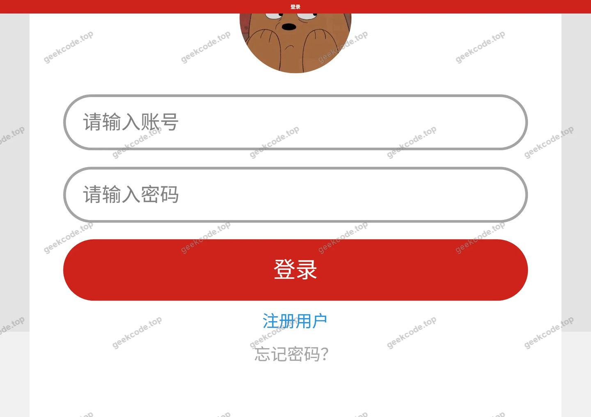</a>

<h3>微信小程序用户端</h3>

<figure><figcaption>小程序-党建学习列表</figcaption></figure>
<figure><figcaption>小程序-党建学习详情</figcaption></figure>
<figure><figcaption>小程序-党政要闻</figcaption></figure>
<figure><a href="https://geekcode.top/archives/%E5%85%9A%E5%BB%BA%E5%B7%A5%E4%BD%9C%E5%B0%8F%E7%A7%98%E4%B9%A6?utm_source=github" title="查看完整源码">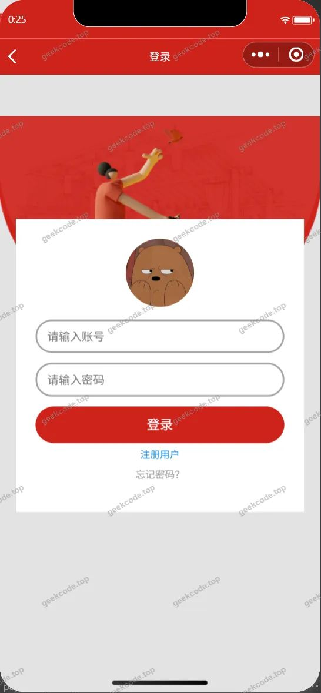</a><figcaption>小程序-登录</figcaption></figure>
<figure><a href="https://geekcode.top/archives/%E5%85%9A%E5%BB%BA%E5%B7%A5%E4%BD%9C%E5%B0%8F%E7%A7%98%E4%B9%A6?utm_source=github" title="查看完整源码">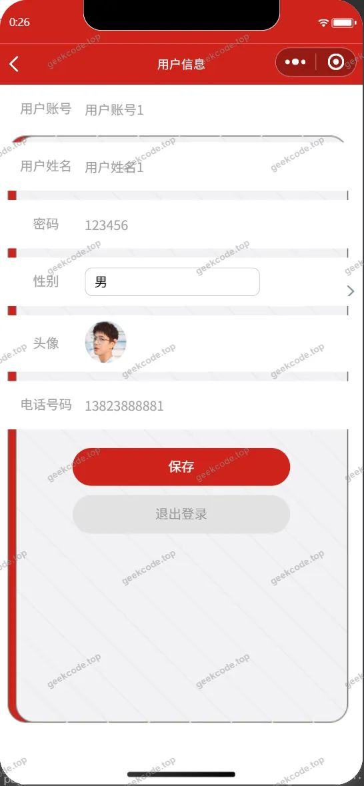</a><figcaption>小程序-个人信息</figcaption></figure>
<figure><figcaption>小程序-考试记录列表</figcaption></figure>
<figure><figcaption>小程序-首页</figcaption></figure>
<figure><figcaption>小程序-忘记密码</figcaption></figure>
<figure><a href="https://geekcode.top/archives/%E5%85%9A%E5%BB%BA%E5%B7%A5%E4%BD%9C%E5%B0%8F%E7%A7%98%E4%B9%A6?utm_source=github" title="查看完整源码">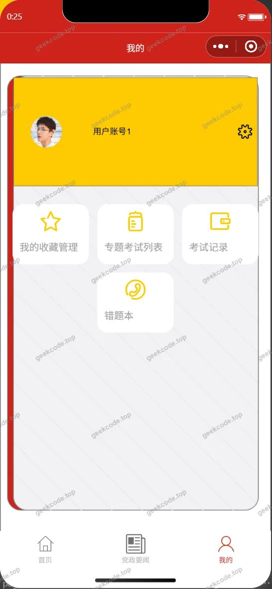</a><figcaption>小程序-我的</figcaption></figure>
<figure><figcaption>小程序-我的收藏列表</figcaption></figure>
<figure><figcaption>小程序-学习动态列表</figcaption></figure>
<figure><figcaption>小程序-支部动态列表</figcaption></figure>
<figure><a href="https://geekcode.top/archives/%E5%85%9A%E5%BB%BA%E5%B7%A5%E4%BD%9C%E5%B0%8F%E7%A7%98%E4%B9%A6?utm_source=github" title="查看完整源码">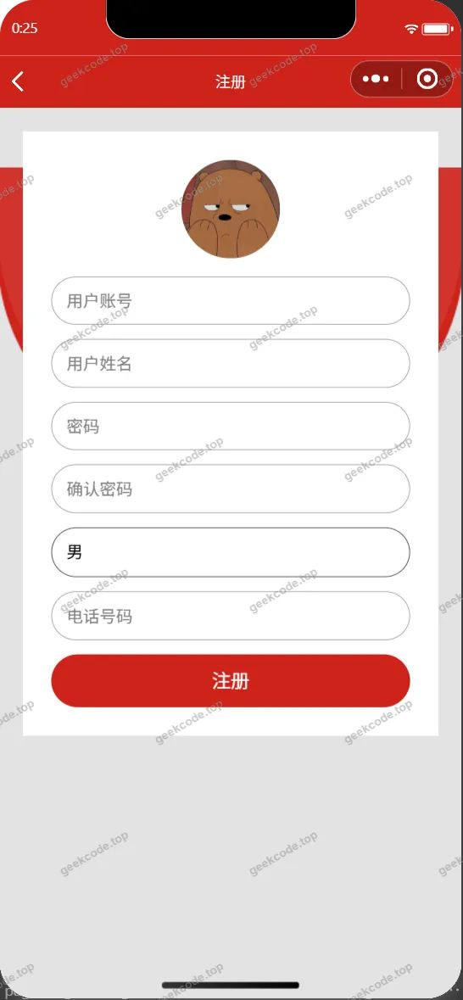</a><figcaption>小程序-注册</figcaption></figure>
<figure><figcaption>小程序-examfailrecord列表</figcaption></figure>
<figure><figcaption>小程序-exampaperlist</figcaption></figure>
<figure><figcaption>小程序-exampaperlist列表</figcaption></figure>

<h3>微信小程序管理端</h3>
<h4>小程序-管理端-知识分类列表</h4>

<h3>后台管理端</h3>
<h4>后台-党建学习评论</h4>

<a href="https://geekcode.top/archives/%E5%85%9A%E5%BB%BA%E5%B7%A5%E4%BD%9C%E5%B0%8F%E7%A7%98%E4%B9%A6?utm_source=github" title="查看完整源码">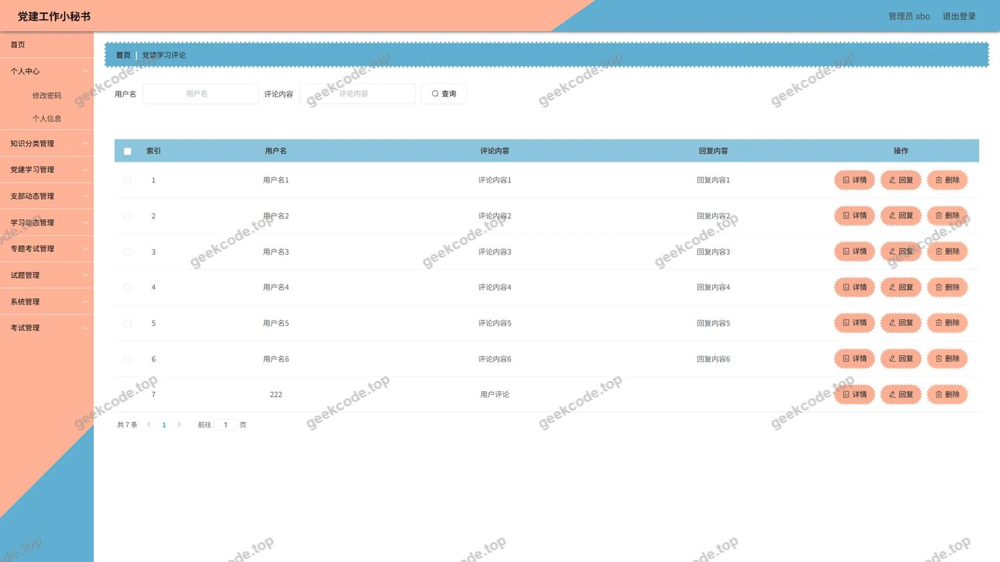</a>

<h4>后台-党政要闻</h4>

<a href="https://geekcode.top/archives/%E5%85%9A%E5%BB%BA%E5%B7%A5%E4%BD%9C%E5%B0%8F%E7%A7%98%E4%B9%A6?utm_source=github" title="查看完整源码">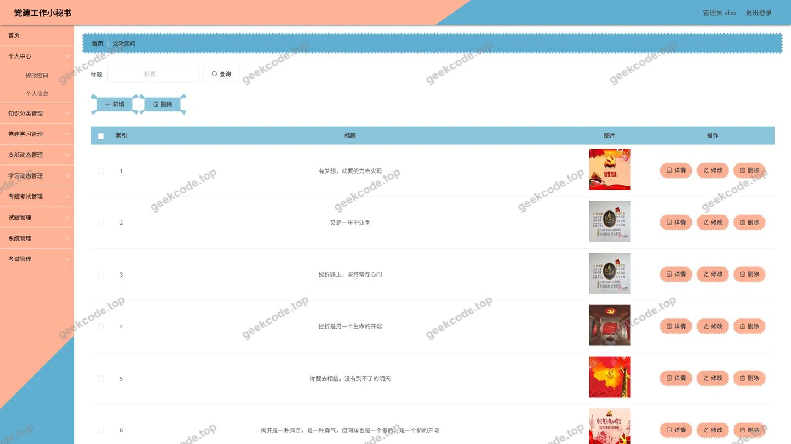</a>

<h4>后台-登录页</h4>

<h4>后台-试题</h4>

<a href="https://geekcode.top/archives/%E5%85%9A%E5%BB%BA%E5%B7%A5%E4%BD%9C%E5%B0%8F%E7%A7%98%E4%B9%A6?utm_source=github" title="查看完整源码">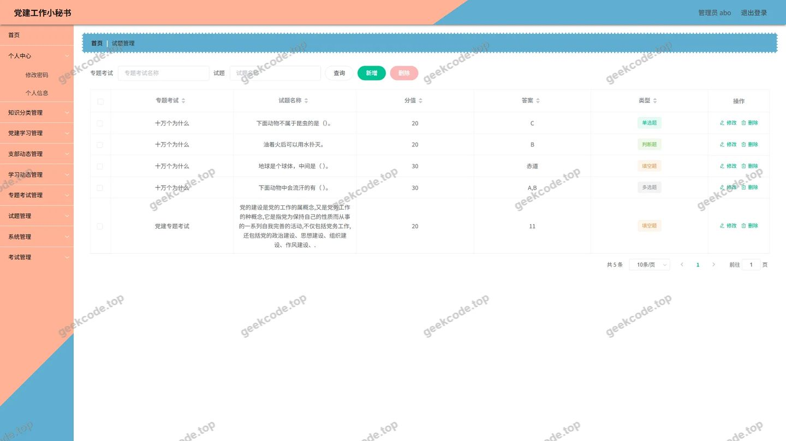</a>

<h4>后台-收藏</h4>

<a href="https://geekcode.top/archives/%E5%85%9A%E5%BB%BA%E5%B7%A5%E4%BD%9C%E5%B0%8F%E7%A7%98%E4%B9%A6?utm_source=github" title="查看完整源码">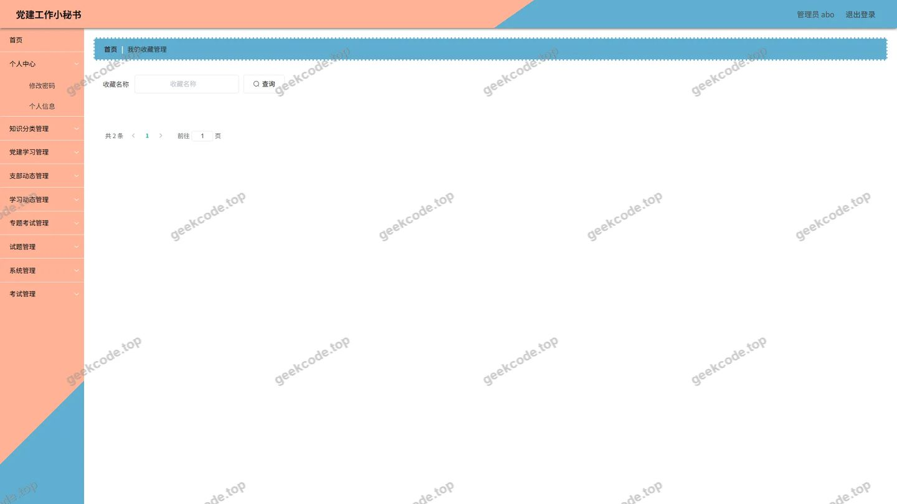</a>

<h4>后台首页</h4>

<a href="https://geekcode.top/archives/%E5%85%9A%E5%BB%BA%E5%B7%A5%E4%BD%9C%E5%B0%8F%E7%A7%98%E4%B9%A6?utm_source=github" title="查看完整源码">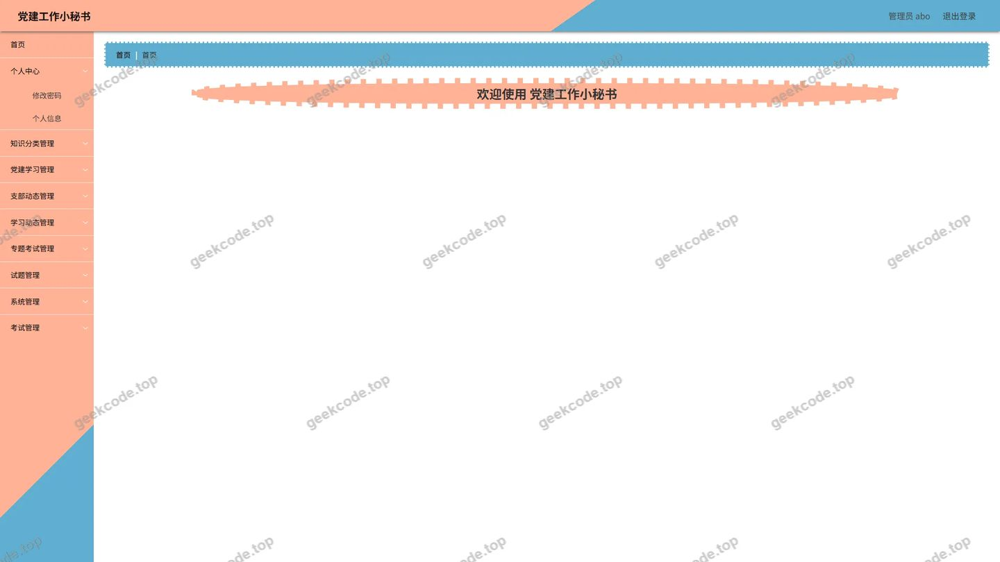</a>

<h4>后台-支部动态</h4>

<a href="https://geekcode.top/archives/%E5%85%9A%E5%BB%BA%E5%B7%A5%E4%BD%9C%E5%B0%8F%E7%A7%98%E4%B9%A6?utm_source=github" title="查看完整源码">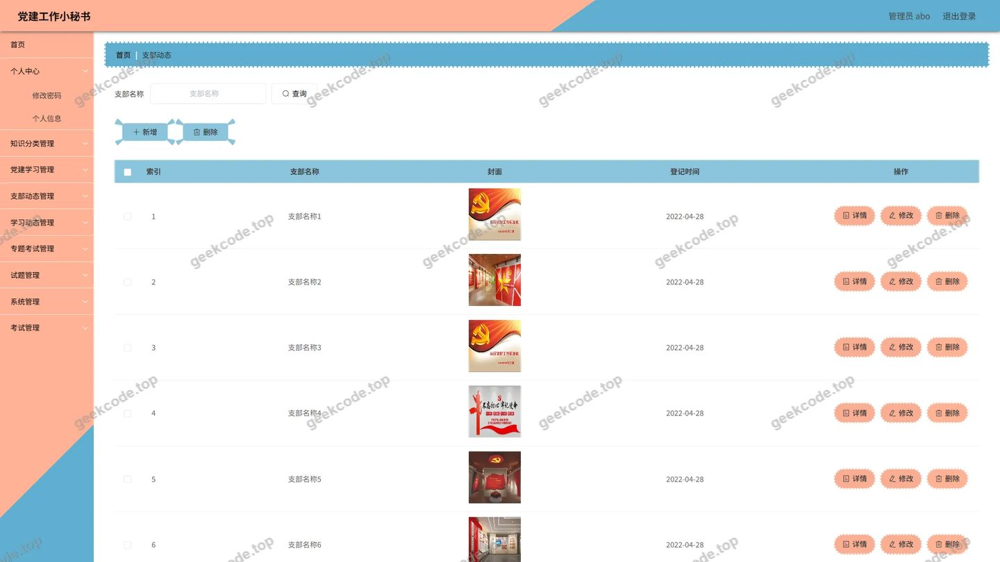</a>

<h4>后台-专题考试</h4>

<a href="https://geekcode.top/archives/%E5%85%9A%E5%BB%BA%E5%B7%A5%E4%BD%9C%E5%B0%8F%E7%A7%98%E4%B9%A6?utm_source=github" title="查看完整源码">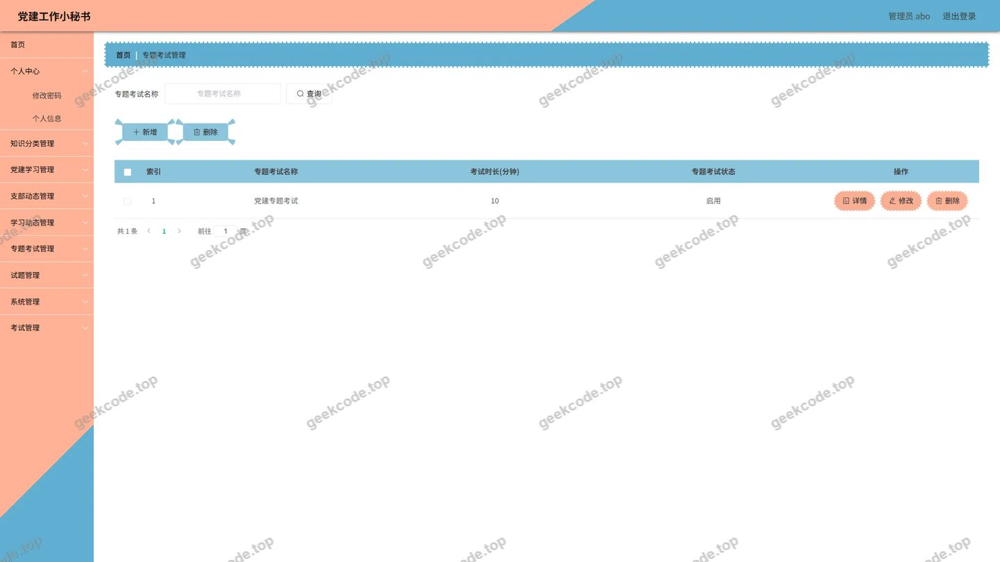</a>

---

## 获取完整源码

| 项目 | 说明 |
| --- | --- |
| 项目名 | 党建工作小秘书 |
| 运行截图 | 本文 26 张（站点带水印原图，仓库 `images/` 目录） |
| 完整源码 | [https://geekcode.top/archives/%E5%85%9A%E5%BB%BA%E5%B7%A5%E4%BD%9C%E5%B0%8F%E7%A7%98%E4%B9%A6?utm_source=github](https://geekcode.top/archives/%E5%85%9A%E5%BB%BA%E5%B7%A5%E4%BD%9C%E5%B0%8F%E7%A7%98%E4%B9%A6?utm_source=github) |
| 咨询微信 | **ir9372**（备注：jingpin-yuanma） |
| 更多项目 | [极客代码 geekcode.top](https://geekcode.top/?utm_source=github) |

> 需要源码、部署、改配置、跑不起来等问题，加微信 ir9372 沟通，说明项目名即可。
